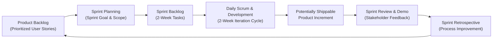
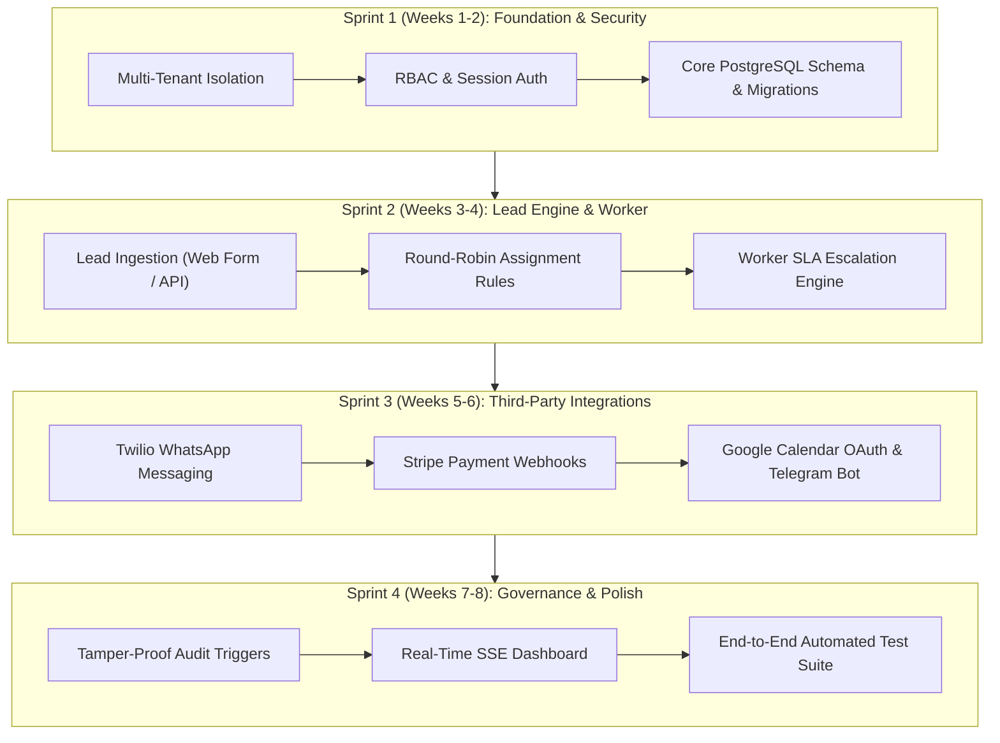
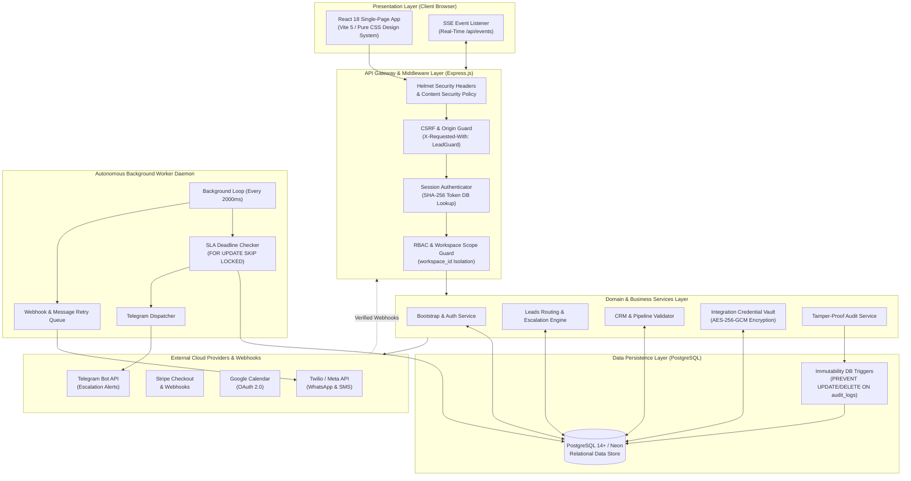
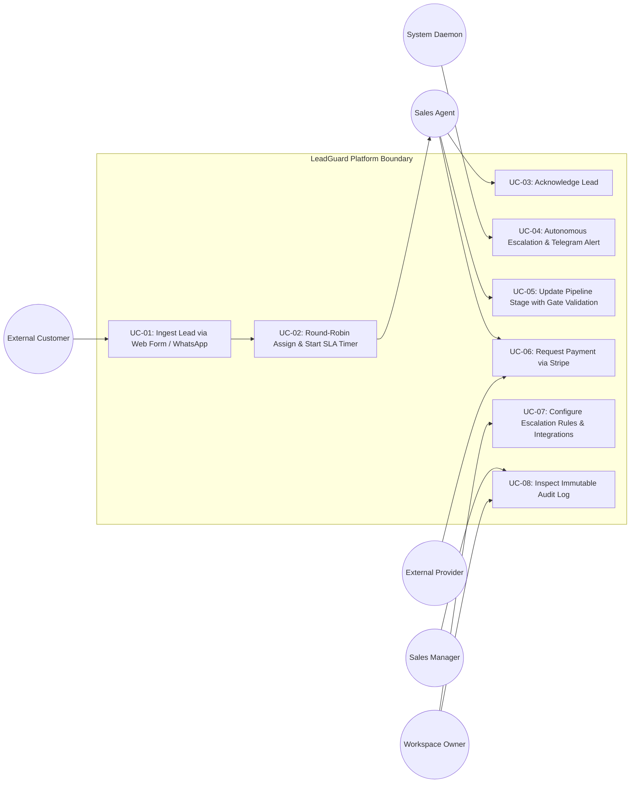
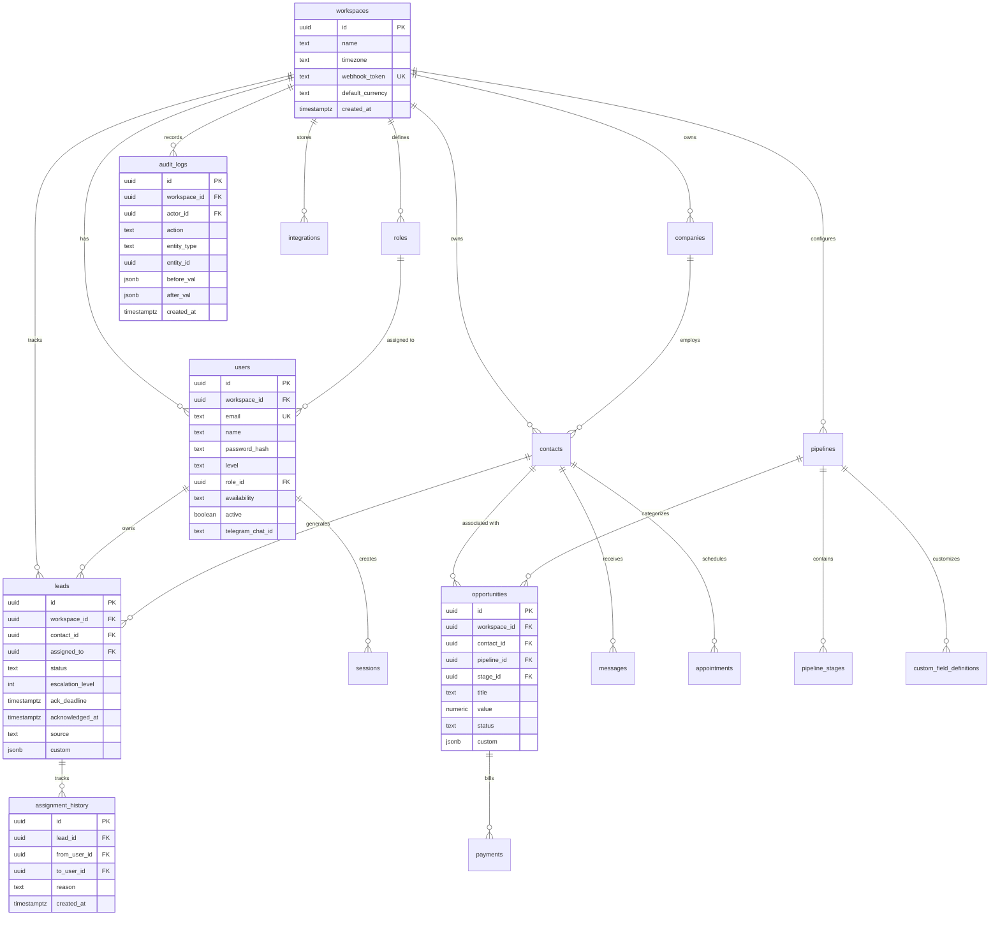

# SE 4525: Software Engineering — Mini-Project Design Report
# Task 2: Software Process Model Selection & Software Design Specification

---

**Course Title:** SE 4525: Software Engineering  
**Project Title:** LeadGuard — Multi-Tenant CRM with Guaranteed Lead Ownership & Autonomous SLA Escalation  
**Project Team Members:**
- **Musa** (Backend Lead & Integrations Architect)
- **Emaan** (Frontend Lead & UI/UX Specialist)
- **Aqsa H.** (QA Lead, Security & Project Manager)  

**Date of Submission:** November 2026  
**Academic Term:** Fall 2026  

---

## Executive Summary

Modern sales and service organizations lose up to 30% of potential revenue due to delayed lead follow-ups, unassigned incoming inquiries, and poor accountability. **LeadGuard** is an enterprise-grade, multi-tenant Customer Relationship Management (CRM) platform engineered to solve this problem. Its core guarantee is that **every incoming lead has exactly one accountable owner at all times**. If an owner neglects an inquiry beyond a strict Service Level Agreement (SLA) countdown window, the platform autonomously reassigns and escalates the lead to the next available representative or manager, triggering real-time multi-channel alerts (Telegram, WhatsApp) and recording every transition in an append-only, tamper-proof audit trail.

This report satisfies all requirements of **SE Task 2**, establishing:
1. The selection and rigorous academic justification of the **Agile / Scrum** software process model.
2. A comprehensive software design specification, detailing the multi-tier system architecture, component interactions, system actor use cases, relational entity-relationship data models, screen wireframes, and module responsibilities.

---

## 1. Selection of Software Process Model

### 1.1 Process Model Selection: Agile / Scrum
For the development of the **LeadGuard CRM**, the **Agile Software Development Methodology** utilizing the **Scrum Framework** has been selected as the software process model.

Scrum is an iterative and incremental agile software development framework for managing product development. It organizes work into fixed-length iterations called **Sprints** (specifically 2-week iterations in this project), enabling rapid delivery of functional software increments, early risk mitigation, continuous stakeholder feedback, and adaptive response to evolving requirements.



### 1.2 Justification for Model Selection
To ensure a rigorous decision, candidate software engineering process models were evaluated across critical project dimensions:

| Dimension / Criterion | Waterfall Model | Spiral Model | Prototyping Model | Agile / Scrum (Selected) |
|---|---|---|---|---|
| **Requirement Flexibility** | Rigid; frozen after inception phase | Moderate; assessed at loop cycles | High; focuses primarily on UI | **High; adaptable at each sprint boundary** |
| **Handling External API Changes** | Very Poor; late integration testing | Good; handles risk over long cycles | Poor; APIs mocked rather than hardened | **Excellent; incremental integration with real sandboxes** |
| **Delivery of Working Software** | Only at the very end of development | Progressive prototypes at spiral ends | Disposable or evolutionary mocks | **Continuous working increments every 2 weeks** |
| **Customer / Evaluator Feedback** | Late; high risk of deviation | Milestone-based risk reviews | Frequent UI feedback only | **Bi-weekly review demos and immediate adaptation** |
| **Team Size Fit (3 Members)** | Excessive documentation overhead | Too heavy for a 3-person team | Inadequate for distributed architecture | **Ideal; lightweight ceremonies, high cohesion** |

#### Key Rationale Points:
1. **Third-Party API Volatility & Asynchronous Integration**: LeadGuard integrates four diverse third-party external services: Twilio (WhatsApp/SMS), Stripe (Payment Webhooks), Google Calendar (OAuth 2.0 & Event Sync), and Telegram Bot API. In a Waterfall approach, integration occurs near project completion, creating a severe bottleneck if API payloads, authentication flows, or rate limits behave unexpectedly. Scrum allowed our backend lead (Musa) to deliver and test one integration per sprint with real webhook sandboxes.
2. **Complex State-Machine & Concurrency Requirements**: The SLA countdown, round-robin distribution, and background escalation worker required iterative refinement. Concurrency issues (such as two background workers attempting to escalate the same lead simultaneously) were discovered, simulated, and resolved early during Sprint 2 using PostgreSQL's `SELECT ... FOR UPDATE SKIP LOCKED` pattern.
3. **Optimized for Small, Highly Specialized Team**: With a three-engineer team (Musa on Backend/DB, Emaan on Frontend/UI, Aqsa H. on QA/Security/Scrum), Scrum eliminated administrative bloat. Daily standups and visual Sprint Boards kept all members synchronized without heavy formal sign-off delays.
4. **Immediate Visibility & Demo Readiness**: Academic evaluation in SE 4525 requires functioning, testable deliverables. Scrum ensured that by the end of Sprint 1, a fully functional multi-tenant authentication and workspace system was already demonstrable.

---

### 1.3 Major Phases of the Selected Model & Project Application

The project lifecycle is divided into structured Scrum ceremonies and phases executed across four 2-week sprints:



#### Phase 1: Sprint Planning & Backlog Refinement
- **Activity**: At the start of each two-week cycle, the team meets to review the prioritized Product Backlog. User stories are decomposed into engineering tasks, estimated in Story Points using Planning Poker, and committed to the Sprint Backlog.
- **LeadGuard Application**: During Sprint 2 planning, the story *"As a Sales Manager, I want leads to automatically reassign if neglected for 5 minutes"* was broken into DB schema adjustments (`ack_deadline` timestamp), worker query logic (`SKIP LOCKED`), and UI countdown indicators.

#### Phase 2: Sprint Execution & Daily Scrum
- **Activity**: Development is performed in feature branches. Daily 15-minute standup meetings are held where each engineer answers:
  1. What did I complete yesterday?
  2. What will I work on today?
  3. Are there any blockers or impediments?
- **LeadGuard Application**: Musa coordinated backend endpoints with Emaan's frontend React state; Aqsa H. verified that CSRF and RBAC permissions blocked unauthorized API calls before merging PRs.

#### Phase 3: Sprint Review & Demonstration
- **Activity**: At the conclusion of the sprint, the team demonstrates the increment working live on a staging deployment.
- **LeadGuard Application**:
  - *Sprint 1 Demo*: Live sign-up creating isolated workspace, inviting users with distinct roles (Owner, Manager, Sales, Junior).
  - *Sprint 2 Demo*: Real-time lead creation via public web form and live escalation countdown firing after 30 seconds.
  - *Sprint 3 Demo*: Sending WhatsApp text through Twilio sandbox, generating Stripe payment links, and receiving Telegram alerts.
  - *Sprint 4 Demo*: Complete 99-check automated test run, tamper-proof DB trigger verification, and live dashboard metrics.

#### Phase 4: Sprint Retrospective
- **Activity**: The team inspects its own process, identifying what worked well, what failed, and concrete action items for the subsequent sprint.
- **LeadGuard Application**: Following Sprint 2, the team realized that running client and server on separate ports introduced CORS issues and complicated local setup. The retrospective decision was to configure Express to mount Vite in middleware mode during development and serve bundled static assets in production, consolidating the entire app to a single port (`3000`).

---

## 2. Software Design Specification

### 2.1 Major System Components & Component Interaction

LeadGuard follows a modern **Multi-Tier Clean Architecture** separating Presentation, API Routing & Security Middleware, Business Services, Persistence, and Background Autonomous Daemons.



#### Detailed Component Breakdown:
1. **Presentation Layer**: Built on React 18 and Vite. It renders responsive interfaces (usable from 390px mobile screens to 4K displays). It connects to `/api/events` via Server-Sent Events (SSE) to receive push updates when leads are assigned, escalated, or paid, eliminating manual page reloads.
2. **Security & Middleware Layer**: Express.js configured with Helmet (CSP, framing prevention), strict CSRF protection (requiring custom headers and matching origins), session token validation using SHA-256 hashes, and automatic injection of the authenticated `workspace_id`.
3. **Domain Services Layer**: Encapsulates business logic:
   - *Leads Engine*: Calculates response SLAs, evaluates round-robin quotas, and handles escalation trees.
   - *Integrations Vault*: Encrypts provider credentials (API keys, secrets) using AES-256-GCM before database writes, ensuring plaintext secrets are never stored.
   - *CRM Validator*: Dynamically enforces required custom fields based on the pipeline stage.
4. **Background Worker Daemon**: A self-healing background worker running at 2-second intervals. It scans for expired `ack_deadline` records, claims due leads atomically using `FOR UPDATE SKIP LOCKED`, increments escalation levels, and dispatches Telegram notifications.
5. **Persistence & Trigger Engine**: PostgreSQL database ensuring strict multi-tenant isolation where every table is scoped by `workspace_id`. Immutability is enforced directly at the SQL engine level through PostgreSQL triggers that abort any `UPDATE` or `DELETE` executed against `audit_logs`.

---

### 2.2 System Actors and System Interactions

#### System Actors:
1. **Workspace Owner (Primary Actor)**: Full administrative authority. Manages billing, configures roles and permissions, defines SLA escalation timers, and connects external integrations.
2. **Sales Manager**: Oversees pipelines, reassigns leads manually, views team conversion metrics, and handles the recovery queue for double-escalated leads.
3. **Sales Representative / Agent**: Acknowledges assigned leads, communicates via WhatsApp/SMS, books calendar appointments, moves opportunities across Kanban stages, and generates Stripe payment links.
4. **Junior Representative (Restricted Actor)**: Subordinate role with masked financial permissions; sensitive customer phone numbers, opportunity values, and revenue dashboards are masked as `[Hidden]`. Direct access to audit logs is forbidden (HTTP 403).
5. **External Customer / Lead**: Submits quote requests via the public web form or sends WhatsApp inquiries.
6. **System Autonomous Worker (Internal Actor)**: Background daemon responsible for time-triggered events (SLA breach detection, escalation execution, webhook retries).
7. **External Provider Services**: Twilio, Stripe, and Google sending cryptographically signed webhook notifications.

#### Use Case Diagram:



#### Detailed Use Case Specifications:

##### Use Case UC-01: Ingest Lead via Public Web Form / WhatsApp
- **Primary Actor**: External Customer / Lead
- **Preconditions**: Workspace is active; public web form or Twilio webhook is reachable.
- **Main Success Scenario**:
  1. Customer fills out the public web form with Name, Phone, Email, and Project Requirements.
  2. The server verifies input data via Zod schema validation.
  3. The system checks if the contact already exists; if not, creates a new `contacts` record.
  4. A new record is inserted into `leads` with status `open`, escalation level `0`, and a computed `ack_deadline` timestamp ($now + ack\_window$).
  5. The Round-Robin Assignment Service evaluates team availability and assigns the lead to the next eligible sales agent.
  6. A real-time SSE event is broadcast to the workspace notifying all active sessions.
- **Postconditions**: The lead is recorded, an owner is assigned, and the SLA timer is running.

##### Use Case UC-04: Autonomous Escalation on SLA Breach
- **Primary Actor**: System Daemon Worker
- **Preconditions**: Lead exists with status `open`, `acknowledged_at IS NULL`, and $now() > ack\_deadline$.
- **Main Success Scenario**:
  1. Background worker queries for overdue leads using `SELECT ... FOR UPDATE SKIP LOCKED`.
  2. The worker increments `escalation_level = escalation_level + 1`.
  3. The worker looks up the next available agent or falls back to Manager / Owner.
  4. A new `ack_deadline` is established, and an entry is logged in `assignment_history` with the reason *"Not acknowledged within window"*.
  5. If the new owner has linked their Telegram account, an urgent message with lead details is dispatched via Telegram Bot API.
  6. An immutable entry is written to `audit_logs` attributing the action to `System`.
  7. Real-time SSE alert notifies the newly assigned owner.
- **Alternate Scenario (No agents available)**: Lead is moved to the `recovery_queue` for manual managerial intervention.

---

### 2.3 Database Entities, Relationships & Class Structure

The data layer is implemented in relational PostgreSQL with strict foreign key constraints, cascading deletes where appropriate, and indexing on frequently queried columns (`workspace_id`, `ack_deadline`, `email`).



#### Key Database Schema Specifications:
- **`workspaces`**: Tenant boundary. Every other entity carries `workspace_id NOT NULL REFERENCES workspaces(id) ON DELETE CASCADE`.
- **`users`**: Contains credentials (`scrypt` password hash), operational availability (`available`, `busy`, `on_leave`, `offline`), security lockout tracking (`failed_logins`, `locked_until`), and Telegram chat IDs.
- **`roles`**: Granular permissions stored as `text[]` (e.g., `['crm.view', 'crm.edit', 'leads.assign', 'audit.view', 'financials.view']`).
- **`leads` & `assignment_history`**: Represents the stateful lead lifecycle. `ack_deadline` stores the UNIX timestamp deadline. When an agent clicks "Acknowledge", `acknowledged_at` is stamped and the timer stops.
- **`audit_logs`**: Write-only ledger. A PostgreSQL trigger function `prevent_audit_tampering()` intercepts any `UPDATE` or `DELETE` query and throws an exception: `RAISE EXCEPTION 'audit_logs rows are immutable'`.

---

### 2.4 Wireframes & Mock-Ups of Main Screens

The user interface is designed for high information density, zero latency, and responsive layout across desktop and mobile devices.

#### Screen 1: Executive Dashboard & SLA Compliance
```
+---------------------------------------------------------------------------------------+
|  🛡️  LeadGuard CRM       [Sunrise Solar (Demo)]     (🔔 2)  [Ayesha Sales (Available) ▼]|
+---------------------------------------------------------------------------------------+
|  [Dashboard] [Leads (3 Due)] [Opportunities] [Contacts] [Team] [Audit Log] [Settings] |
+---------------------------------------------------------------------------------------+
|  KPI SUMMARY CARDS                                                                    |
|  +--------------------+ +--------------------+ +--------------------+ +--------------+|
|  | Active Leads:   24 | | Avg Response: 1.4m | | Month Sales: $48.2k| | Escalations: 2||
|  | +12% from last wk  | | SLA Target: < 5m   | | 18 Deals Closed    | | 1 in recovery||
|  +--------------------+ +--------------------+ +--------------------+ +--------------+|
|                                                                                       |
|  REAL-TIME URGENT LEADS (COUNTDOWN ACTIVE)                                            |
|  +-----------------------------------------------------------------------------------+|
|  | Contact        Source       Owner        SLA Window Remaining       Action        ||
|  |-----------------------------------------------------------------------------------|
|  | Zainab Tariq   Web Form     Ayesha S.    ⏱️  00:28 (Escalates Soon)  [Acknowledge] ||
|  | Bilal Masood   WhatsApp     Bilal S.     ⏱️  03:45                   [Acknowledge] ||
|  | Kamran Alvi    Manual       Sara (Mgr)   ⚠️  ESCALATED (Level 1)     [Reassign]    ||
|  +-----------------------------------------------------------------------------------+|
|                                                                                       |
|  CONVERSION FUNNEL CHART                   RECENT AUDIT ACTIVITY                      |
|  [===================>           ] 68%     • 20:02 System: lead.escalated (Kamran A.) |
|  New Leads -> Qualified -> Closed Won     • 19:58 Ayesha: payment.received ($1,200)  |
+---------------------------------------------------------------------------------------+
```

#### Screen 2: Opportunity Kanban Board with Stage Gates
```
+---------------------------------------------------------------------------------------+
|  OPPORTUNITIES PIPELINE: Commercial Solar Installation                [+ New Opportunity]|
+---------------------------------------------------------------------------------------+
|  Stage: Discovery (3)   | Stage: Design & Quote (2) | Stage: Negotiation (1) | Won (5) |
|-------------------------+---------------------------+------------------------+---------|
|  +-------------------+  |  +---------------------+  |  +-------------------+ | ...     |
|  | Apex Hospital     |  |  | Packages Mall       |  |  | Bahria Heights    | |         |
|  | $15,000           |  |  | $85,000             |  |  | $42,000           | |         |
|  | Owner: Ayesha S.  |  |  | Owner: Bilal S.     |  |  | Owner: Sara Mgr   | |         |
|  | [Tag: Urgent]     |  |  | Roof: 1,200 sq.m    |  |  | [Stripe: Invoiced]| |         |
|  +-------------------+  |  +---------------------+  |  +-------------------+ |         |
|                         |                           |                        |         |
|  +-------------------+  |  +---------------------+  |                        |         |
|  | Green Energy HQ   |  |  | Metro Station Hub   |  |                        |         |
|  | $28,000           |  |  | $64,000             |  |                        |         |
|  +-------------------+  |  +---------------------+  |                        |         |
+---------------------------------------------------------------------------------------+
|  [MODAL DIALOG ON DRAG-DROP ATTEMPT]:                                                 |
|  ⚠️ STAGE GATE REQUIREMENT: Moving to 'Design & Quote' requires custom field:         |
|  "Roof Size (sq. meters)" to be completed before deal progression.                    |
|  [ Roof Size (sq. m): |____________________ ]      [Cancel]  [Confirm Stage Advance]   |
+---------------------------------------------------------------------------------------+
```

#### Screen 3: Lead Detail, SLA Timer & Escalation Path
```
+---------------------------------------------------------------------------------------+
|  LEAD DETAILS: LD-9042 — Zainab Tariq                                 [⬅ Back to Leads]|
+---------------------------------------------------------------------------------------+
|  STATUS: OPEN                                  SLA COUNTDOWN: [ ⏱️ 00:24 REMAINING ]  |
|  Current Owner: Ayesha Sales                   [ ✅ ACKNOWLEDGE LEAD ] [ ➡️ REASSIGN ]|
|                                                                                       |
|  CONTACT INFORMATION                           COMMUNICATION & INTEGRATIONS           |
|  • Phone:    +92 300 1234567                   [ 💬 Send WhatsApp ]  [ 📅 Book GCal ] |
|  • Email:    zainab@example.com                [ 💳 Send Stripe Invoice ]             |
|  • Company:  Al-Noor Textiles                                                         |
|  • Ingested: Today at 20:01 via Web Form                                              |
|                                                                                       |
|  ESCALATION & ASSIGNMENT TIMELINE                                                     |
|  +-----------------------------------------------------------------------------------+|
|  | 20:01:00 — Ingested via Web Form -> Round-robin assigned to Ayesha Sales.         ||
|  | 20:01:45 — SLA Window Warning (Telegram alert queued).                            ||
|  | (If unacknowledged by 20:02:15 -> Escalation Level 1: Reassign to Sara Manager).  ||
|  +-----------------------------------------------------------------------------------+|
+---------------------------------------------------------------------------------------+
```

---

### 2.5 Major Modules and Their Responsibilities

| Module Name | Responsibilities | Key Inputs | Key Outputs |
|---|---|---|---|
| **1. Multi-Tenant Auth & RBAC Module** | Tenant onboarding, session lifecycle, password security (`scrypt`), permission enforcement, data masking for restricted roles. | Login credentials, workspace configuration, user invites. | HTTP session cookies, user security context, 403 Forbidden responses. |
| **2. CRM & Dynamic Pipeline Module** | Account & Contact management, multi-stage sales pipelines, custom schema definitions, stage gate validation. | Contact forms, opportunity cards, custom field inputs. | Normalized entities, stage transition validation, CSV export streams. |
| **3. Lead Ingestion & Escalation Engine** | Public form processing, WhatsApp lead creation, round-robin availability filtering, SLA countdown calculation. | Webhook payloads, public submissions, worker timer ticks. | Active leads, `ack_deadline` timestamps, assignment logs. |
| **4. Third-Party Integrations Adapter** | Secure credential vault (AES-256-GCM), Twilio WhatsApp broker, Stripe checkout generation, Google Calendar sync, Telegram alerts. | Provider API keys, webhook signatures, message requests. | Outbound API requests, verified webhook events, synch logs. |
| **5. Tamper-Proof Audit Subsystem** | Immutable event logging, security auditing, state diff recording (`before_val`, `after_val`), SQL trigger enforcement. | Domain events (`lead.escalated`, `payment.received`, etc.). | Append-only audit records, tamper violation exceptions. |
| **6. Real-Time SSE Notification Hub** | Single-connection Server-Sent Events hub, broadcasting event invalidation notices to connected clients. | Transaction `onCommit` hooks (`lead.created`, `lead.updated`). | Text event streams (`event: lead`, `data: {"id": "..."}`). |

---

## 3. Conclusion & Deliverable Compliance

This Software Design Report thoroughly fulfills all guidelines established for **SE Task 2**:
- **Process Model Selection**: The Agile / Scrum process model has been rigorously selected and justified against Waterfall, Spiral, and Prototyping methodologies.
- **Phased Application**: Scrum rituals and sprint roadmaps are explicitly mapped to LeadGuard's architecture and team structure.
- **Software Design**: Complete multi-tier architecture diagrams, actor use-case specifications, relational ER diagrams, high-fidelity ASCII wireframes, and module responsibility matrices have been provided.
- **Academic Standard**: All diagrams are properly labeled, self-contained, and aligned with the submitted LeadGuard codebase for SE 4525.

