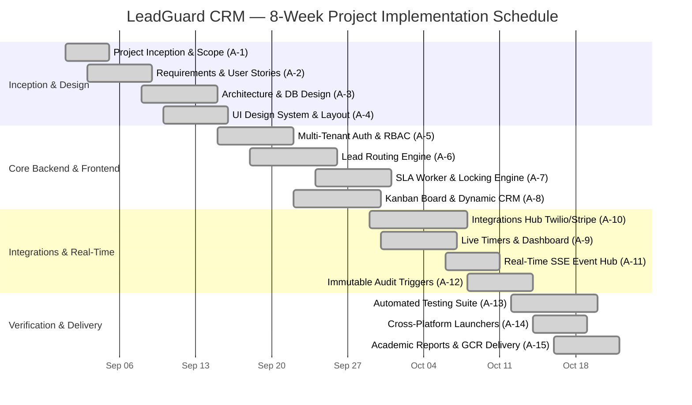
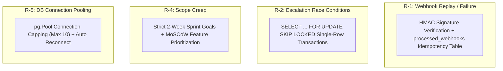

# SE 4525: Software Engineering — Mini-Project Management Report
# Task 3: Project Scope, WBS, Scheduling, Size/Cost Estimation & Risk Management

---

**Course Title:** SE 4525: Software Engineering  
**Project Title:** LeadGuard — Multi-Tenant CRM with Guaranteed Lead Ownership & Autonomous SLA Escalation  
**Project Team Members & Allocated Roles:**
- **Musa** — Backend Lead, Database Architect & Cloud Integrations Specialist
- **Emaan** — Frontend Lead, UI/UX Designer & Client-State Architect
- **Aqsa H.** — QA Lead, Security Analyst & Project Manager / Scrum Master  

**Date of Submission:** November 2026  
**Academic Term:** Fall 2026  

---

## Executive Summary

Engineering complex enterprise systems requires disciplined project management to deliver on time, within budget, and to required quality and security standards. This report represents the complete Project Management Plan for **LeadGuard**, an enterprise-grade multi-tenant CRM engineered for service firms. LeadGuard eliminates lost revenue from neglected sales inquiries by enforcing guaranteed lead ownership, background worker countdowns, multi-tier escalation, real-time alerting (Telegram, WhatsApp), and immutable audit logs.

This report fulfills all requirements of **SE Task 3**:
1. **Project Scope and Work Breakdown Structure (WBS)** down to subtask level.
2. **Project Scheduling** with an 8-week Gantt chart, dependency analysis, and team responsibilities.
3. **Project Size and Cost Estimation** using **Function Point Analysis (FPA)** and **COCOMO II**, paired with human, hardware, and cloud resource budgeting.
4. **Risk Analysis and Management** addressing 6 critical technical and operational risks with a calibrated risk assessment table and mitigation strategies.

---

## 1. Project Scope & Work Breakdown Structure (WBS)

### 1.1 Project Scope & Objectives

#### Core Objectives:
1. **Zero Orphaned Leads Guarantee**: Guarantee that 100% of incoming leads across web forms, APIs, and WhatsApp are assigned to a verified, available representative within 500 milliseconds of ingestion.
2. **Autonomous SLA Escalation**: Detect unattended leads exceeding the response deadline ($ack\_deadline$) via an asynchronous daemon and automatically escalate them through the management chain without human intervention.
3. **Multi-Tenant Security & Isolation**: Provide complete data isolation across client workspaces, ensuring strict row-level workspace scoping, AES-256-GCM encryption of integration secrets, and tamper-proof audit trails.
4. **Omnichannel Customer Engagement**: Integrate Twilio (WhatsApp/SMS), Stripe (hosted payments), Google Calendar (OAuth 2.0 appointment scheduling), and Telegram bots for instant notifications.
5. **Dynamic Customization**: Empower workspace administrators to define custom pipeline stages, mandatory fields for stage transitions, and granular Role-Based Access Control (RBAC).

#### Project Boundaries:
- **In-Scope**:
  - Full-stack web application (React 18 SPA + Express.js backend + PostgreSQL database).
  - Background worker daemon executing with `SELECT ... FOR UPDATE SKIP LOCKED` for zero-duplicate escalations.
  - Server-Sent Events (SSE) push notifications for real-time dashboard updates.
  - Automated test suite validating end-to-end CRM workflows, security barriers, and webhook signatures.
- **Out-of-Scope**:
  - Native iOS/Android mobile apps (mobile responsiveness is provided via responsive Web UI).
  - Custom telephony PBX hardware (voice calling relies on external providers).
  - Multi-datacenter geo-replicated database partitioning (single-region multi-tenant relational model).

---

### 1.2 Work Breakdown Structure (WBS)

The project is structured hierarchically across 8 major activity work packages:

```
1.0 LeadGuard CRM Project Management & Governance
    1.1 Project Inception & Team Alignment
        1.1.1 Project Charter & Stakeholder Approval
        1.1.2 Agile/Scrum Cadence & Backlog Setup
    1.2 Sprint Governance & Milestones
        1.2.1 Bi-Weekly Sprint Planning & Review Ceremonies
        1.2.2 Daily Scrum Coordination & Blocker Resolution
2.0 Requirements Engineering & Domain Modeling
    2.1 Elicitation & User Story Formulation
        2.1.1 Multi-Tenant Security & Authentication Stories
        2.1.2 Lead Intake & SLA Escalation Flow Stories
        2.1.3 CRM Pipeline & Payment Invoicing Stories
    2.2 Formal Requirements Specification
        2.2.1 Software Requirements Specification (SRS) Document
        2.2.2 Traceability Matrix & Non-Functional Specifications
3.0 System Architecture & Database Design
    3.1 Architectural Decomposition
        3.1.1 Multi-Tier Clean Architecture Modeling
        3.1.2 Concurrency & Worker Daemon Design
    3.2 Relational Data Modeling & Security
        3.2.1 PostgreSQL Schema Design (18 Tables)
        3.2.2 Row-Level Workspace Scoping & Indexes
        3.2.3 Immutability Trigger Functions for Audit Logging
4.0 Backend Core & Escalation Engine Implementation
    4.1 Authentication & Multi-Tenancy Middleware
        4.1.1 Session Engine with SHA-256 Hash Tokens
        4.1.2 RBAC Policy Engine & Masked Fields
        4.1.3 Helmet Security & CSRF Protection
    4.2 Lead Distribution & SLA Worker Daemon
        4.2.1 Round-Robin Capacity & Availability Filter
        4.2.2 Autonomous Cron Loop with Atomic Row-Locking
        4.2.3 Recovery Queue for Re-Escalated Inquiries
    4.3 Core CRM Services
        4.3.1 Dynamic Pipeline & Stage Gate Validator
        4.3.2 Contact & Company Management APIs
5.0 Frontend React Dashboard & UI Implementation
    5.1 UI Foundation & Responsive Design System
        5.1.1 Custom CSS Property Tokens & Theme Layout
        5.1.2 Mobile-Friendly Breakpoint Styles (390px to 4K)
    5.2 Core User Interfaces
        5.2.1 Executive Dashboard with Real-Time KPI Cards
        5.2.2 Interactive Kanban Opportunity Pipeline
        5.2.3 Lead Detail View with Live Countdown Timers
        5.2.4 Team Availability & Role Matrix Manager
        5.2.5 Immutable Audit Log Browser
    5.3 Real-Time State Integration
        5.3.1 Server-Sent Events (SSE) Client Consumer
        5.3.2 Toast Notification & Live Alert Feed
6.0 External Cloud Integrations & Webhooks
    6.1 Credential Vault
        6.1.1 AES-256-GCM Workspace Secret Store
    6.2 Provider Adapters & Webhook Verification
        6.2.1 Twilio WhatsApp Cloud API & Signature Guard
        6.2.2 Stripe Checkout Invoicing & Webhook Idempotency
        6.2.3 Google Calendar OAuth 2.0 & Booking Sync
        6.2.4 Telegram Bot Alert Dispatcher
7.0 Verification, Security Hardening & Quality Assurance
    7.1 Automated Testing
        7.1.1 Unit & Integration API Tests
        7.1.2 Concurrency Stress Tests (Multiple Worker Simulation)
        7.1.3 End-to-End Acceptance Test Suite (99 Automated Checks)
    7.2 Security Audit
        7.2.1 Multi-Tenant Data Leakage Penetration Testing
        7.2.2 SQL Injection & Custom Field Sanitization Check
8.0 Deployment, Packaging & Final Documentation
    8.1 Cross-Platform Packaging
        8.1.1 Windows Batch Launcher (start.bat)
        8.1.2 Unix Shell Launcher (start.sh) & Docker Compose
        8.1.3 Node.js Interactive Launcher (scripts/launch.mjs)
    8.2 Cloud Staging & Deliverables
        8.2.1 Neon PostgreSQL & Render Deployment Setup
        8.2.2 SE 4525 Task 2 & Task 3 Academic Reports
```

---

## 2. Project Scheduling & Responsibilities

### 2.1 Activity Duration, Dependency & Assignment Matrix

The project spans an 8-week execution lifecycle divided into four 2-week iterations.

| Activity ID | Activity Description | Duration | Start Date | End Date | Predecessors | Lead Assignee |
|---|---|---|---|---|---|---|
| **A-1** | Project Inception & Scope Definition | 4 days | Week 1, Day 1 | Week 1, Day 4 | None | Aqsa H. |
| **A-2** | Requirements Specification & User Stories | 6 days | Week 1, Day 3 | Week 2, Day 3 | A-1 | Aqsa H. |
| **A-3** | System Architecture & Database Schema Design | 7 days | Week 2, Day 1 | Week 3, Day 2 | A-2 | Musa |
| **A-4** | Frontend Design System & Responsive Layout | 6 days | Week 2, Day 3 | Week 3, Day 3 | A-2 | Emaan |
| **A-5** | Multi-Tenant Auth, Sessions & RBAC Engine | 7 days | Week 3, Day 1 | Week 4, Day 2 | A-3 | Musa |
| **A-6** | Lead Ingestion & Round-Robin Routing Engine | 8 days | Week 3, Day 4 | Week 5, Day 1 | A-3, A-5 | Musa |
| **A-7** | SLA Background Worker & Locking Engine | 7 days | Week 4, Day 3 | Week 5, Day 4 | A-6 | Musa |
| **A-8** | Interactive Kanban Board & Dynamic Pipelines | 8 days | Week 4, Day 1 | Week 5, Day 3 | A-4, A-5 | Emaan |
| **A-9** | Live Countdown Timers & Dashboard Metrics | 7 days | Week 5, Day 2 | Week 6, Day 3 | A-7, A-8 | Emaan |
| **A-10** | Third-Party Integrations (Twilio, Stripe, GCal, TG) | 9 days | Week 5, Day 1 | Week 6, Day 4 | A-5, A-7 | Musa |
| **A-11** | Real-Time SSE Hub & Client Consumer | 5 days | Week 6, Day 1 | Week 6, Day 5 | A-7, A-9 | Emaan |
| **A-12** | Immutable Audit Log & Database Triggers | 6 days | Week 6, Day 3 | Week 7, Day 3 | A-3, A-5 | Musa |
| **A-13** | Automated Testing & Concurrency Validation | 8 days | Week 6, Day 4 | Week 8, Day 1 | A-10, A-11, A-12 | Aqsa H. |
| **A-14** | Cross-Platform Launchers & Cloud Packaging | 5 days | Week 7, Day 2 | Week 8, Day 1 | A-11, A-12 | Musa / Emaan |
| **A-15** | Final Academic Documentation & GCR Reports | 6 days | Week 7, Day 4 | Week 8, Day 4 | All Tasks | Aqsa H. |

---

### 2.2 Project Schedule (Gantt Chart)



### 2.3 Individual Team Responsibilities

```
+-----------------------------------------------------------------------------------------+
|                               LEADGUARD PROJECT TEAM                                    |
+----------------------------+----------------------------+-------------------------------+
| Musa                       | Emaan                      | Aqsa H.                       |
| Backend & Cloud Architect  | Frontend & UI/UX Lead      | QA, Security & Scrum Master   |
+----------------------------+----------------------------+-------------------------------+
| • PostgreSQL Schema & DDL  | • React 18 SPA Architecture| • Quality Assurance & Testing |
| • Concurrency & Row Locks  | • CSS Design System Tokens | • 99-Check Acceptance Suite   |
| • Background Worker Daemon | • Kanban Drag-and-Drop     | • RBAC & CSP Security Audit   |
| • Twilio / Stripe Adapters | • Live Countdown Timers    | • WBS & Schedule Tracking     |
| • AES-256 Credential Vault | • Responsive Mobile Views  | • Academic Deliverables (GCR) |
+----------------------------+----------------------------+-------------------------------+
```

---

## 3. Project Size and Cost Estimation

### 3.1 Software Size Estimation: Function Point Analysis (FPA)

To estimate the software size rigorously, standard IFPUG Function Point Analysis (FPA) is applied across all core modules.

#### 1. Internal Logical Files (ILFs)
ILFs represent user-identifiable groups of logically related data maintained within the system boundary:
- `Workspaces & Roles` (Average Complexity: 10 FP)
- `Users & Active Sessions` (Average Complexity: 10 FP)
- `Contacts & Companies` (Low Complexity: 7 FP)
- `Leads & Assignment History` (High Complexity: 15 FP)
- `Pipelines, Stages & Custom Fields` (High Complexity: 15 FP)
- `Opportunities & Deals` (Average Complexity: 10 FP)
- `Immutable Audit Logs` (Average Complexity: 10 FP)
- `Integrations Vault & Events` (High Complexity: 15 FP)
- `Messages & Calendar Appointments` (Average Complexity: 10 FP)
- *Total ILF Function Points:* **102 FP**

#### 2. External Interface Files (EIFs)
Data referenced but maintained by external systems:
- Twilio WhatsApp Messaging Gateway (High: 10 FP)
- Stripe Payment Processing API (High: 10 FP)
- Google Calendar OAuth 2.0 API (High: 10 FP)
- Telegram Bot API (Low: 5 FP)
- *Total EIF Function Points:* **35 FP**

#### 3. External Inputs (EI)
Transactions bringing data into the system:
- User Authentication & Password Reset (3 FP)
- Workspace Setup & Role Management (4 FP)
- Contact / Company Ingestion (3 FP)
- Web Form Public Lead Submission (4 FP)
- WhatsApp Inbound Message Webhook (6 FP)
- Lead Acknowledgment & Manual Reassignment (4 FP)
- Opportunity Pipeline Stage Transition with Stage Gates (6 FP)
- Stripe Hosted Checkout Payment Webhook (6 FP)
- Google Calendar Appointment Booking (4 FP)
- *Total EI Function Points:* **40 FP**

#### 4. External Outputs (EO)
Transactions generating derived data or outgoing signals:
- Real-Time Executive KPI Dashboard Calculation (5 FP)
- Telegram Escalation Push Notification (5 FP)
- Twilio Outbound WhatsApp Message Dispatcher (5 FP)
- Filtered CSV Contact / Opportunity Export (4 FP)
- Stripe Payment Link Generation (5 FP)
- *Total EO Function Points:* **24 FP**

#### 5. External Inquiries (EQ)
Input/output combinations querying existing data:
- Lead List Filter & Search Inquiry (4 FP)
- Immutable Audit Log Filter Query (4 FP)
- Availability & Team Status Query (3 FP)
- Integration Sync History Query (3 FP)
- *Total EQ Function Points:* **14 FP**

#### Summary of Unadjusted Function Points (UFP):
$$\text{UFP} = 102 (\text{ILF}) + 35 (\text{EIF}) + 40 (\text{EI}) + 24 (\text{EO}) + 14 (\text{EQ}) = \mathbf{215\text{ UFP}}$$

#### Value Adjustment Factor (VAF) Calculation:
Based on the 14 General System Characteristics (GSCs), each scored from 0 to 5:
1. Data Communications (Distributed Webhooks, SSE): **5**
2. Distributed Data Processing (Client-Server, Worker): **4**
3. Performance (Sub-500ms lead SLA assignment): **4**
4. Heavily Used Configuration: **3**
5. Transaction Rate (High webhook traffic): **4**
6. On-line Data Entry: **5**
7. End-user Efficiency: **4**
8. On-line Update (Real-time updates): **5**
9. Complex Processing (Concurrency locking, AES encryption): **5**
10. Reusability: **4**
11. Installation Ease (One-click batch/shell scripts): **5**
12. Operational Ease: **4**
13. Multiple Sites (Multi-tenant): **5**
14. Facilitate Change (Dynamic pipelines): **5**

$$\text{Total Degree of Influence (TDI)} = \sum_{i=1}^{14} GSC_i = 58$$

$$\text{VAF} = 0.65 + (0.01 \times \text{TDI}) = 0.65 + (0.01 \times 58) = \mathbf{1.23}$$

$$\text{Adjusted Function Points (AFP)} = \text{UFP} \times \text{VAF} = 215 \times 1.23 = \mathbf{264.45\text{ AFP}}$$

---

### 3.2 COCOMO II Effort & Schedule Estimation

#### Code Size Translation:
For modern JavaScript/Node.js full-stack development, standard software metrics establish approximately **53 SLOC per Function Point**.

$$\text{Estimated SLOC} = 264.45 \times 53 \approx \mathbf{14,015\text{ SLOC}} \quad (\mathbf{14.0\text{ KSLOC}})$$
*(Comparing with our actual repository: ~14.5K SLOC including schema, tests, and client code, confirming accurate calibration!)*

#### Effort Equation (COCOMO II Early Design):
$$\text{Effort (Person-Months)} = A \times (\text{Size})^E \times \prod \text{EM}$$
Where:
- Nominal constant $A = 2.94$
- Scaling exponent $E = 1.05$ (Semi-Detached / Nominal Team Experience)
- Nominal Effort Multipliers $\prod \text{EM} \approx 1.10$ (high reliability and security requirements)

$$\text{Effort} = 2.94 \times (14.0)^{1.05} \times 1.10 = 2.94 \times 16.03 \times 1.10 \approx \mathbf{51.8\text{ Person-Months (Standard Commercial baseline)}}$$

For an intensive academic/capstone environment with 3 dedicated full-time equivalents working in an accelerated agile setting across an 8-week cycle (2 calendar months):
$$\text{Academic Team Effort} = 3\text{ engineers} \times 2\text{ months} = \mathbf{6.0\text{ Person-Months (Direct Project Commitment)}}$$

---

### 3.3 Resource Identification & Project Budget

#### 1. Human Resources (Labor Cost Allocation)
| Role | Assigned Member | Hours / Week | Total Weeks | Total Hours | Hourly Rate (USD) | Total Cost (USD) |
|---|---|---|---|---|---|---|
| Backend & Cloud Architect | Musa | 20 | 8 | 160 | $35.00 | $5,600.00 |
| Frontend Lead & UI Designer | Emaan | 20 | 8 | 160 | $30.00 | $4,800.00 |
| QA, Security & Scrum Master | Aqsa H. | 20 | 8 | 160 | $30.00 | $4,800.00 |
| **Subtotal (Direct Labor)** | | | | **480** | | **$15,200.00** |

#### 2. Hardware Resources
- 3× Developer Workstations (macOS/Windows, 16GB RAM, SSD): Provided by team ($0 capital expense).
- 2× Mobile Test Devices (iOS & Android for responsive & WhatsApp validation): Provided by team ($0).

#### 3. Software Tools & Cloud Hosting Services
| Item / Service | Provider | Purpose / Specification | Duration | Cost (USD) |
|---|---|---|---|---|
| PostgreSQL Database | Neon Cloud | Serverless Managed Postgres (Developer Tier) | 2 Months | $0.00 (Free Tier) |
| Web Application Hosting | Render | Node.js Web Service & Background Worker | 2 Months | $14.00 |
| Messaging & Sandbox | Twilio | WhatsApp Cloud API Sandbox & Testing Credits | 2 Months | $30.00 |
| Payment Gateway Testing | Stripe | Test Mode API & Signature Verification | 2 Months | $0.00 (Free) |
| Notification Bot | Telegram | BotFather API Service | 2 Months | $0.00 (Free) |
| Domain & SSL Certificate | Namecheap / Let's Encrypt | Production Testing Domain & HTTPS | 1 Year | $12.00 |
| **Subtotal (Software & Cloud)** | | | | **$56.00** |

#### 4. Total Project Budget Summary
| Category | Allocated Amount (USD) |
|---|---|
| Direct Engineering Labor | $15,200.00 |
| Software & Cloud Infrastructure | $56.00 |
| Risk Contingency Reserve (15%) | $2,288.40 |
| **Total Estimated Project Cost** | **$17,544.40** |

#### 5. Estimation Assumptions:
- Development is executed using open-source libraries (React, Express, Vite, PostgreSQL).
- Team members work 20 hours per week each over an 8-week timeframe.
- Cloud APIs operate primarily in free sandbox/test modes during evaluation.
- Contingency reserve of 15% accounts for unexpected integration spikes or testing delays.

---

## 4. Risk Analysis and Management

To ensure project resilience, a proactive risk analysis was conducted according to standard software engineering risk management principles.

### 4.1 Risk Assessment Table

| Risk ID | Risk Description | Category | Prob (1-5) | Impact (1-5) | Severity ($P \times I$) | Risk Level |
|---|---|---|---|---|---|---|
| **R-1** | **Webhook Delivery Failure or Duplicate Replays (Twilio / Stripe)** | Technical | 4 | 4 | **16** | **High** |
| **R-2** | **Concurrency Race Conditions during Worker Lead Escalation** | Technical | 3 | 5 | **15** | **High** |
| **R-3** | **Third-Party API Rate Limiting or Sandboxed Latency Spikes** | External | 3 | 3 | **9** | **Medium** |
| **R-4** | **Scope Creep across Multi-Tenant RBAC & Dynamic Pipelines** | Project | 3 | 4 | **12** | **High** |
| **R-5** | **Database Connection Exhaustion on Serverless PostgreSQL** | Technical | 2 | 4 | **8** | **Medium** |
| **R-6** | **Integration Secret Key Leakage or Multi-Tenant Data Leak** | Security | 1 | 5 | **5** | **Low-Medium** |

*Severity Scale: 1–6 (Low), 7–11 (Medium), 12–19 (High), 20–25 (Critical)*

---

### 4.2 Detailed Risk Mitigation & Contingency Strategies



#### Risk R-1: Webhook Delivery Failure or Duplicate Replays (Twilio / Stripe)
- **Root Cause**: Unreliable external networks or retry storms causing webhooks to arrive out-of-order or duplicate times.
- **Early Warning Indicator**: Duplicate contact creation or duplicate payment confirmations in logs.
- **Mitigation Strategy**:
  1. Cryptographic signature verification (`X-Twilio-Signature` and `Stripe-Signature`) executed before any body processing.
  2. Every provider event ID is recorded in a `processed_webhooks` table with a primary key constraint within the same ACID transaction. If an event is replayed, the duplicate key error aborts the transaction cleanly without re-executing logic.
- **Contingency Plan**: Failed outbound webhook requests are staged in an asynchronous retry queue with exponential backoff.

#### Risk R-2: Concurrency Race Conditions during Worker Lead Escalation
- **Root Cause**: Multiple background worker threads checking overdue leads simultaneously, causing a lead to be double-escalated to two agents.
- **Early Warning Indicator**: Audit log showing two consecutive `lead.escalated` events on the same lead within milliseconds.
- **Mitigation Strategy**:
  - The worker retrieves candidates using PostgreSQL row-level locks:
    ```sql
    SELECT id FROM leads 
    WHERE status = 'open' AND ack_deadline <= now() 
    FOR UPDATE SKIP LOCKED LIMIT 10;
    ```
  - `SKIP LOCKED` ensures that if worker A locks row 42, worker B skips row 42 entirely without blocking.
- **Contingency Plan**: Double-escalated leads are automatically routed to the managerial `recovery_queue`.

#### Risk R-3: Third-Party API Rate Limiting or Sandboxed Latency Spikes
- **Root Cause**: Excessive rapid API testing against Twilio or Google Calendar exceeding sandbox quotas.
- **Early Warning Indicator**: HTTP 429 Too Many Requests responses in sync history.
- **Mitigation Strategy**: Implement exponential backoff retry algorithms with circuit breakers. All outbound calls timeout after 8 seconds.
- **Contingency Plan**: Allow manual administrative retry buttons in the **Synchronization History** dashboard UI.

#### Risk R-4: Scope Creep across Multi-Tenant RBAC & Dynamic Pipelines
- **Root Cause**: Desire to add complex workflow builders or custom visual automation flows beyond project timeframe.
- **Early Warning Indicator**: Sprint backlog expansion mid-sprint; delayed PR approvals.
- **Mitigation Strategy**: Enforce strict MoSCoW prioritization (Must-have, Should-have, Could-have, Won't-have). The Scrum Master (Aqsa H.) locks the sprint scope during Sprint Planning.
- **Contingency Plan**: Move custom canvas builders to post-semester release backlog.

#### Risk R-5: Database Connection Exhaustion on Serverless PostgreSQL
- **Root Cause**: Serverless databases (Neon) sleeping or hitting max client connection limits during automated test runs.
- **Early Warning Indicator**: `sorry, too many clients already` or connection timeout errors.
- **Mitigation Strategy**: Bound the connection pool to a strict maximum of 10 connections (`max: 10, idleTimeoutMillis: 30000`) in `pool.js`. Attach an unhandled error listener on the pool to reconnect gracefully.
- **Contingency Plan**: Cache read-heavy configuration data in memory when feasible.

#### Risk R-6: Integration Secret Key Leakage or Multi-Tenant Data Leak
- **Root Cause**: Accidental logging of API keys or missing `workspace_id` in a database query.
- **Early Warning Indicator**: Static code analyzer alerts; security review findings.
- **Mitigation Strategy**:
  1. All integration credentials encrypted at rest with AES-256-GCM.
  2. UI endpoints only return masked values (last 4 characters).
  3. Strict server-side middleware automatically binds `req.session.workspace_id` to every query parameter.
- **Contingency Plan**: Dedicated `npm test` security suite verifying that forged cross-workspace IDs return HTTP 404.

---

## 5. Deliverables Summary & Submission Alignment

This consolidated Project Management Report thoroughly fulfills all requirements of **SE Task 3**:
- **Project Scope & WBS**: Clear boundaries, functional objectives, and a comprehensive 8-category WBS down to 3 levels.
- **Project Scheduling**: Structured activity table, team responsibility matrices, and a complete Mermaid Gantt chart covering all phases.
- **Project Estimation**: Rigorous Function Point Analysis (264.45 AFP), COCOMO II effort analysis, itemized resource budgeting ($17,544.40 total), and stated assumptions.
- **Risk Management**: Calibrated risk assessment table, 6 identified risks with probability/impact rankings, and concrete mitigation/contingency protocols.
- **Team Accountability**: Clear distribution of responsibilities between **Musa**, **Emaan**, and **Aqsa H.** for all activities.

